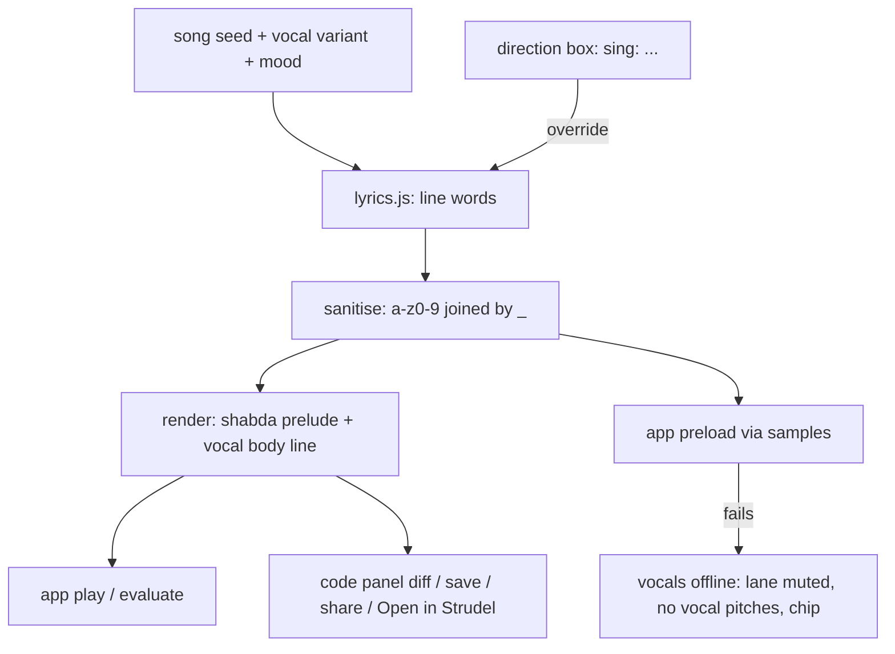

# feat: AI-generated vocals as an eighth part

## Summary

Add a **vocal** part the DJ writes and pitches like any other: it generates a short lyric line from the song's seed and mood, voices it through Shabda text-to-speech (keyless, no backend), and chops and pitches it onto the track's key and rhythm. Vocals ride the existing Without/With → Keep/Bin/Another take loop, the record, the code panel, saves and share links; you can override the words with `sing: …` in the direction box.

---

## Problem Frame

Every track today is instrumental. Vibe DJ's pitch is "the DJ writes every note"; a voice is the most audible gap. A real AI singer needs an API key, which a static, backend-free app cannot keep secret, so the voice comes from Shabda — Strudel's own text-to-speech sample service — and the "AI" is the DJ writing the lyrics and arranging the chop. It sounds like a vocal chop, not a singer; that is the accepted trade-off.

---

## Requirements

**The part**
- R1. A new vocal lane joins the seven existing parts, with its own chip, colour, roll lane and ring on the record.
- R2. The DJ pitches "bring in a vocal", reworks (new line or new chop), FX and doubles on it through the normal loop; "Another take" gives a different line.
- R3. The vocal follows the song's key/scale and sits on the bar grid; it never plays outside the sections an arranged track gives it.

**The words**
- R4. Lyrics are generated deterministically from the song seed, the vocal variant and the mood — same seed, same words, offline.
- R5. `sing: <words>` in the direction box replaces the generated line for this song; `no vocals` / `more vocals` ban and feature it like other parts.
- R6. Every word that reaches code or Shabda is sanitised to lowercase letters and digits joined by `_`, capped in length; nothing user-typed is interpolated raw.

**Robustness and persistence**
- R7. If Shabda can't be reached, the vocal part goes quiet, vocal pitches stop, a chip says so, and nothing else breaks.
- R8. Saved records, share links and Open in Strudel carry the vocal (the code includes its Shabda load line); records saved before this change still load, play, remix and share.
- R9. The A/B level match, code diff, undo and Let it run treat the vocal like any other part.

---

## Key Technical Decisions

- **Vocal is lane index 7; the fill pseudo-lane moves to `STAGES.length + 1`.** The fill currently borrows index 7 for its code line and its ring (`FILL_IDX`, `vinyl.js` case 7). Moving the fill to a constant derived from the stage count avoids a collision and stops future lanes repeating this.
- **Old seven-lane genomes are padded, not rejected.** One engine helper normalises any genome to the current lane count (vocal off, variant 0, no FX). It runs everywhere a genome enters: `loadSong`, crate/remix loads, the restore points. `loadSong` accepts 7 or 8-length arrays.
- **One Shabda sample per lyric line, sliced for rhythm.** The whole line is one multi-word sample (`neon_lights_tonight`), played with `slice` over the bar and pitched with a note pattern. A multi-word name almost never collides with a dirt-samples bank name (`yeah`, `ho` exist there); single-word lines are disallowed for that reason.
- **The rendered code is self-contained.** When the vocal is active, `render()` emits a `samples('shabda/speech:<line>')` prelude before `setcps`, so crate previews, MP3 export and strudel.cc play it without app help. The app also preloads the line when the pitch is made, because Shabda samples load lazily and the first hit is otherwise silent.
- **Lyrics module, not the engine.** A new `src/lyrics.js` (like `names.js`) owns word banks per mood and the sanitiser; the engine calls it. Keeps `dj.js` musical and makes the sanitiser testable alone.
- **Typed words are song state, not genome.** `sing:` sets a song-level lyric override, carried in share params (validated by the same sanitiser). The genome stays numeric, so `loadSong`'s validation model holds.
- **The vocal unlocks after three parts** and is weighted like the lead, so it never opens a bare-kick track.

---

## High-Level Technical Design

---

## Implementation Units

### U1. Lyrics generator and sanitiser

- **Goal:** Deterministic lyric lines and a single safe-word sanitiser.
- **Requirements:** R4, R6
- **Dependencies:** none
- **Files:** `src/lyrics.js` (new), `index.html` (script order: after `names`, before `dj`), `test/app_test.js` (loader list + checks)
- **Approach:** Word banks per mood family (bright / dark / dreamy / hype) with short line templates of 2–5 words; `line(seed, variant, mood)` draws via `SDJ.Rng`. `sanitise(text)` lowercases, strips everything but letters/digits/spaces, collapses to `_`, caps at about 6 words / 40 chars, and returns null for fewer than 2 words.
- **Patterns to follow:** `src/names.js` (seeded word generation), `src/rng.js`.
- **Test scenarios:**
  - Same seed + variant + mood → identical line; a different variant → a different line.
  - Every generated line passes the sanitiser unchanged and has 2+ words.
  - `sanitise('Hello, World!')` → `hello_world`; quotes, parens, backticks, `${}` and newlines are stripped.
  - One word or empty input → null; a 20-word input is capped.
- **Verification:** lines read as plausible lyrics across moods; no generated or sanitised output contains a character outside `[a-z0-9_]`.

### U2. Engine: the vocal lane

- **Goal:** The eighth lane in the genome, render, arrangement and pitching.
- **Requirements:** R1, R2, R3, R9
- **Dependencies:** U1
- **Files:** `src/dj.js`, `test/app_test.js`
- **Approach:** Add the stage and colour; derive `FILL_IDX` from the stage count; build genome arrays from the stage count rather than literals; add the normalise helper and use it in `loadSong` (accept 7 or 8). The vocal body line slices the line sample across the bar and pitches it on scale degrees from the song's progression; variant picks line and chop pattern. Emit the Shabda prelude when active. Arranged track: vocal in the peaks only. Count it in `loudness()`. Add to proposal candidates after three parts; retake on the vocal draws a new line.
- **Patterns to follow:** the lead lane (seeded via its own lane RNG, always filtered), `effEnergyIdx`, `retakeChange`'s differ-until-distinct loop.
- **Test scenarios:**
  - A seeded song that accepts a vocal renders a balanced program with the prelude first and `s("<line>")` in the body.
  - The vocal is never pitched before three parts are active.
  - Retake on a vocal pitch changes the line; the new render differs and stays balanced.
  - `renderArranged` carries the vocal only in peak sections and stays balanced.
  - A legacy seven-lane genome (and seven-length share params) loads, renders identically to before, and gains a vocal-off lane.
  - The fill still renders and maps its code line to the fill lane, not the vocal.
  - Every genre: 15 accepted pitches including vocals keep loop, mid-fader and arranged renders balanced (extend the existing per-genre loop).
- **Verification:** existing render tests unchanged for vocal-free songs; vocal songs balanced across all renders.

### U3. App: loading Shabda and the offline path

- **Goal:** Vocals audible on first hit, and graceful when Shabda is down.
- **Requirements:** R7, R9
- **Dependencies:** U2
- **Files:** `src/app.js`, `test/app_test.js`
- **Approach:** Before auditioning a pitch whose render contains a new line, call `window.samples('shabda/speech:<line>')` once per line (cache the set). On rejection or timeout, mark vocals offline for the session: ban vocal adds, drop an active vocal from playback, flash a chip. The code panel, diff and A/B work unchanged because the vocal is just another lane.
- **Patterns to follow:** `ensureAudio` (best-effort sample loads with fallback), `flashChip`.
- **Test scenarios:**
  - A stubbed `samples` records one call per new line, none for repeats.
  - A rejecting stub → vocals offline: no further vocal pitches, chip shown, live audio still evaluates balanced code.
  - The A/B Without side of a vocal add equals the committed track (existing guarantee holds).
- **Verification:** in a real browser the vocal is heard on its first audition; with the network to Shabda blocked the set continues instrumentally.

### U4. Visuals: chip, ring and roll

- **Goal:** The vocal looks like a part.
- **Requirements:** R1
- **Dependencies:** U2
- **Files:** `src/vinyl.js`, `src/app.js`, `styles.css`, `test/app_test.js`
- **Approach:** A home groove radius for an eighth lane and a signature ring (a wavy waveform band); the fill ring moves to the new fill index. Chips and the "/N parts" count already follow the stage count.
- **Test scenarios:**
  - Eight part chips render; the vocal chip cycles DJ decides → feature → drop.
  - A genome with an active vocal draws its ring on Deck A; a vocal pitch draws it on Deck B's acetate.
  - A legacy crate record without a vocal still gets a vinyl face.
- **Verification:** Playwright screenshot of a vocal track: ring visible, distinct from fill and lead.

### U5. Direction box: sing, no vocals, more vocals

- **Goal:** Steer the vocal in words.
- **Requirements:** R5, R6
- **Dependencies:** U1, U2
- **Files:** `src/curate.js`, `src/app.js`, `test/app_test.js`
- **Approach:** Lane words `vocal(s)`, `voice`, `singing` map to the vocal lane, so ban/feature/soften work unchanged. `sing: <words>` (rest of the clause) sets the song's lyric override through the sanitiser and brings the vocal in; clearing the box lifts it. Receipt chip: "sing — now ‘neon lights tonight’".
- **Patterns to follow:** existing ban/feature directives and receipt chips.
- **Test scenarios:**
  - `no vocals` drops an active vocal and bans its add; `more vocals` brings it in.
  - `sing: hello world` makes the vocal line `hello_world` in the render and preload call.
  - `sing: '); evil(` produces no code characters (sanitised or refused with a chip).
  - The lane-word coupling check spans exactly the stage count (update the existing check).
- **Verification:** typing directions changes what you hear within one evaluate.

### U6. Persistence, sharing and docs

- **Goal:** Vocals survive save, share and export; old records keep working.
- **Requirements:** R8
- **Dependencies:** U2, U5
- **Files:** `src/dj.js` (`songParams`/`loadSong`), `src/app.js` (crate, remix load, share), `README.md`, `CLAUDE.md`, `test/app_test.js`
- **Approach:** Share params gain the optional lyric override (sanitised on both ends). Crate and remix loads normalise genomes. Open in Strudel already sends the self-contained code. Document the vocal lane, the Shabda dependency and the third-party data note.
- **Test scenarios:**
  - A vocal record's share link re-renders the same code, including a `sing:` override.
  - A share link with a non-sanitised override is refused or sanitised — never reaches code raw.
  - A pre-change seven-lane crate record loads into Remix, plays and shares.
- **Verification:** saving, sharing and reopening a vocal track round-trips its code exactly.

---

## Scope Boundaries

- Sung (melodic, sustained) vocals from an AI singing model — needs a backend and a key.
- Language-model-written lyrics — offline word banks only.
- Recording or uploading your own voice.
- New Remix vocal tools; vocal records simply play there.
- Caching Shabda audio in the crate (would bloat `localStorage`); records depend on Shabda staying up.

---

## Risks & Dependencies

- **Third-party service.** Shabda (a free community server) can be slow, rate-limited or gone; saved vocal records then lose the vocal. Mitigation: offline path (U3); vocal-free parts are unaffected.
- **Typed words leave the browser.** `sing:` text is sent to Shabda's TTS. The README should say so.
- **Code injection.** Lyrics are the first user text to enter rendered code. Mitigation: one sanitiser on every path (generate, type, share), tested with hostile input.
- **Pitching speech.** How Strudel pitches an unpitched sample (`note` vs `speed`, base pitch) must be probed against the real CDN bundle, as earlier APIs were.
- **Lane-count ripple.** Hard-coded seven-length arrays exist in the engine, app and test; missing one silently drops the vocal from opinions or validation.

---

## Open Questions

### Deferred to Implementation

- `note` vs `speed` for pitching the line, and whether `slice` or `splice` sounds better — probe against the CDN bundle.
- Whether evaluating a `samples(...)` prelude inside `evaluate()` awaits or races (the app preload covers the live case either way).
- Exact word banks and templates — tune by ear.

---

## Sources & Research

- Strudel samples docs (Shabda speech syntax `shabda/speech[/lang/gender]:words`, multi-word via `_`, lazy loading, `slice`/`splice`, pitch via `note`/`speed`): https://strudel.cc/learn/samples/
- Repo patterns: `src/names.js` (seeded words), lead lane render in `src/dj.js`, `songParams`/`loadSong` validation, `retakeChange`.
